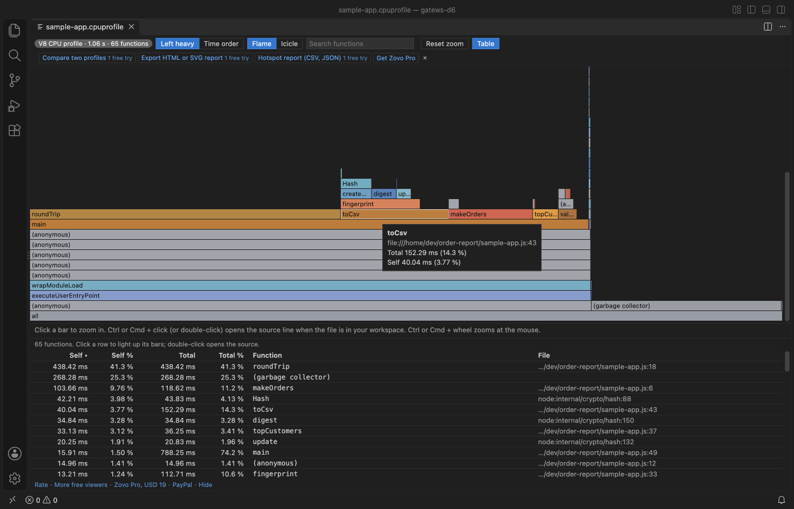

# Flame Graph & pprof Viewer

Open a CPU or memory profile as a flame graph in a VS Code tab and find the slow code: search, zoom, a table of self and total time, and a click that opens the source line. Works offline, with no account. Made by Zovo.

Free, with no account and no network calls:

- Opens .cpuprofile and .heapprofile (Node.js, Chrome DevTools), Chrome trace JSON, Go pprof (.pb.gz, .pprof, .prof), collapsed stacks (.folded), perf script text and speedscope JSON.
- Flame graph (root at the bottom) or icicle chart (root at the top).
- Left heavy order (identical call paths merged, the heaviest first) or time order (the samples as they happened).
- Search a function or file, and see what share of the total it takes. Click a bar to zoom in; Ctrl or Cmd + wheel zooms at the mouse.
- A table of every function with self and total time (or memory), sorted the way you click.
- Ctrl or Cmd + click a bar, or double-click a row, to open its source line when the file is in your workspace.
- Every thread of a Chrome trace and every sample type of a pprof file (CPU, alloc_space, inuse_space ...) in one picker.
- Large files are read in a stream in a background thread, so a profile of several hundred MB opens without freezing the editor.

Zovo Pro: USD 19 once, for the Pro tools in every Zovo extension. Each Pro tool has 1 free try on your computer first:

- Compare two profiles: a before and an after profile as one red and blue flame graph (red grew, blue shrank), with a regression table you can save as CSV.
- Export HTML or SVG report: one standalone file for a pull request or a ticket. The HTML report has search, zoom and the top functions; the SVG has a tooltip on every bar.
- Hotspot report (CSV, JSON): the top functions by self time or memory with their share of the total, saved as CSV and as a JSON summary a CI step can read.

## How to use it

- Click a `.pb.gz`, `.pprof`, `.prof`, `.folded`, `.collapsed`, `.perf` or `.speedscope.json` file, or a Chrome `Trace-*.json` file. It opens as a flame graph.
- VS Code opens `.cpuprofile` and `.heapprofile` in its own table view. Click the flame icon in that view's title bar, or right-click the file and choose Open as Flame Graph. Reopen Editor With > Flame Graph makes it the default.
- Any other `.json`, `.txt` or `.log` profile: right-click it and choose Open as Flame Graph.
- Keys in the graph: `/` or Ctrl+F searches, `Escape` resets the zoom, `L` and `T` switch left heavy and time order, `F` and `I` switch flame and icicle, `B` shows or hides the table.
- To try it without a profile of your own, run Flame Graph: Open the Sample Node.js CPU Profile, or Open the Sample Go pprof Profile.
- The Pro tools are in the Command Palette (Flame Graph: ... (Pro)), in the Explorer right-click menu (select two profiles to compare them), in the editor title bar and in the small row at the end of the viewer toolbar. The row closes with its x for the rest of the session, and the setting `flameGraph.showProTools` hides it for good.

## What it reads

| File | Made by | What shows |
|---|---|---|
| `.cpuprofile` | `node --cpu-prof`, Chrome DevTools, the VS Code JavaScript debugger | CPU time per function, time order |
| `.heapprofile` | `node --heap-prof`, Chrome DevTools | Sampled allocated bytes per function |
| Chrome trace `.json` | Chrome DevTools Performance (Save profile), chrome://tracing, `node --trace-events-enabled`, Perfetto JSON export, Hermes | The JavaScript CPU profile inside it, and the trace events of each thread |
| `.pb.gz`, `.pprof`, `.prof` | Go `runtime/pprof`, `go test -cpuprofile`, `net/http/pprof`, pprof-rs and other pprof writers | Every sample type (CPU, samples, alloc and inuse space and objects), inlined functions |
| `.folded`, `.collapsed` | stackcollapse scripts, py-spy, rbspy, async-profiler, bpftrace and others | Stacks with counts, file order |
| `.perf` and other perf script text | `perf script` after `perf record -g` | Samples per process, time order |
| `.speedscope.json` | Tools that export the speedscope file format | Sampled and evented profiles |

## Privacy

The extension reads the file you open and nothing else. It makes no network calls, and nothing is uploaded or measured. The Pro tools write only the files you ask for, next to the profile. The links at the bottom of the viewer (Rate, More free tools, Zovo Pro) open a page only when you click them, and the setting `flameGraph.showSupportLinks` hides them.

## Settings

| Setting | Default | What it does |
|---|---|---|
| `flameGraph.maxFileSizeMB` | 2048 | Larger files open with a message instead of the graph. |
| `flameGraph.defaultOrder` | left | Left heavy or time order when a profile opens. |
| `flameGraph.direction` | flame | Root at the bottom (flame) or at the top (icicle). |
| `flameGraph.hotspotCount` | 50 | How many functions the hotspot report lists. |
| `flameGraph.showProTools` | true | Shows the Pro tools in menus, the palette and the toolbar row. |
| `flameGraph.showSupportLinks` | true | Shows the Rate, More free tools and Zovo Pro links. |
| `flameGraph.askForRating` | true | Asks once for a rating after two good uses at least 30 minutes apart. |

## Zovo Pro

One payment of USD 19 unlocks the Pro tools in every Zovo extension on your computers; a team of 5 is USD 59. The key works offline. Run Zovo Pro: Get Zovo Pro from the Command Palette, or click Get Zovo Pro in the toolbar row. The Zovo Pro tab lists this extension's Pro tools and whether your free try is left before any payment page opens.

## License

MIT, by Zovo. The flame graph renderer, the pprof decoder and every reader are written for this extension; gzip uses Node's built-in zlib. See THIRD-PARTY-NOTICES.md for the sample files.
